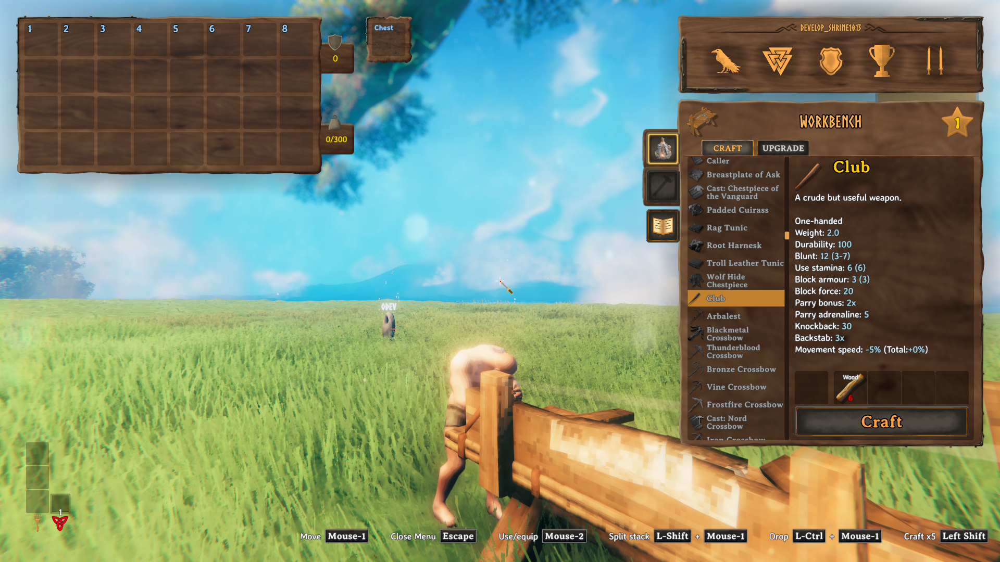

# Server guide button validation

Validated on 2026-10-14 on Valnet Client 01 at 1920×1080.

The guide button now uses the Repair button's frame and hover/pressed sprites.
It sits directly below Repair, with a 12-unit gap. Its book has a dark cover,
shaded pages, and visible lines. The button remains usable when Repair is hidden
or disabled. It does not copy Repair's action or controller shortcut.

## Live checks

- Used the maintained `praetoris-season-8` profile and `TestingWorld` with a development character.
- Compared client package manifests with the deployed Season 8 `8.0.43` manifest and installed mismatched package versions before testing. Copied production guide content for this local-world test.
- Confirmed the original header icon opened the guide before installing the candidate.
- Opened inventory with Tab and clicked the new book with mouse input. The guide opened with all 48 pages.
- Confirmed the old header icon was absent.
- Opened a temporary workbench and confirmed the book sat below the disabled Repair button. Clicking the book still opened the guide.
- Closed the guide with Escape and repeated the flow.
- Removed the temporary workbench and reset time, weather, and tutorial settings.

`dotnet build -c Release` passed with the same 84 warnings as the unchanged source.
The candidate DLL SHA-256 was `6b0a667a562e1b40689233fe513720987adb76df1779f40b14d658856e3a2614`.

After removing timestamps and command timeouts during loading, the candidate log
had no new warning/error messages compared with the baseline. Both runs had
existing shader and mod compatibility warnings. The baseline also reported a
Balrond shutdown error and required termination after logout.

## Video evidence

`server-guide-button-demo.mp4` is a 13-second, silent, 1920×1080 H.264 recording:
inventory opens, the pointer hovers over the book, and a click opens the guide.
The original recording, exported video, inspected frames, screenshots, and logs
are retained in `~/Develop/valheim-validation-evidence/guide-button-20261014/`.
The capture and export were inspected directly because the automatic review
helper's configured models were unavailable.

This validates the local client interface with the current production client
mod set. It does not repeat multiplayer guide synchronization or controller testing.
